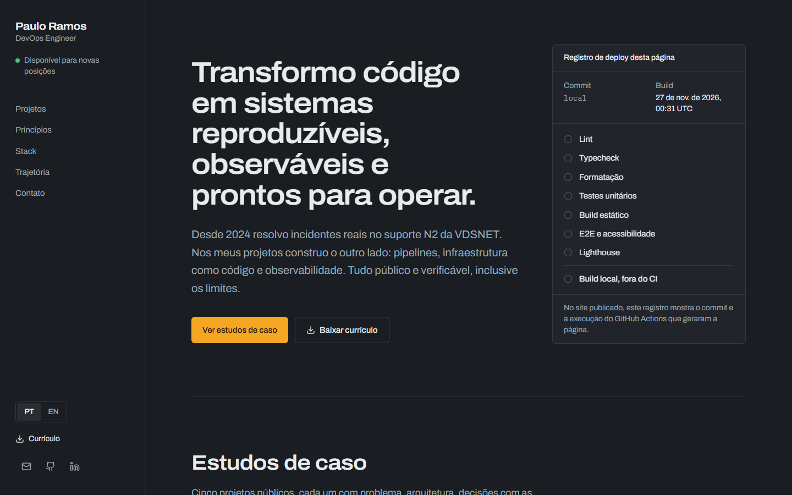
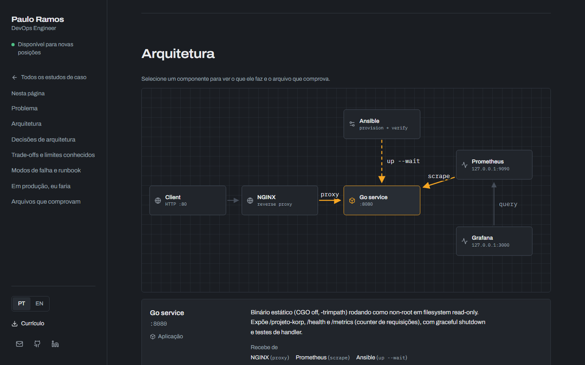

# Paulo Ramos · DevOps Engineer

[](https://github.com/DavidDevd/pauloramos.github.io/actions/workflows/deploy.yml)

**Live site:** https://daviddevd.github.io/pauloramos.github.io/ (Portuguese) · [English](https://daviddevd.github.io/pauloramos.github.io/en/)

A bilingual portfolio built around one idea: **evidence over claims**. Every
project is a case study with architecture, decisions and the alternatives
rejected, trade-offs, a failure runbook and links to the exact files that
prove each statement. The site itself is run like a production system: it
shows the commit and pipeline run that deployed the page you are reading.



## Case studies

| Case                                                                                                                       | What it proves                                                                                                             |
| -------------------------------------------------------------------------------------------------------------------------- | -------------------------------------------------------------------------------------------------------------------------- |
| [Project Korp](https://daviddevd.github.io/pauloramos.github.io/en/projects/projeto-korp/)                                 | Verification as part of the deploy: Ansible only succeeds once the app, Prometheus and Grafana confirm the expected state. |
| [AWS Multi-Environment IaC](https://daviddevd.github.io/pauloramos.github.io/en/projects/aws-multi-environment-iac/)       | Blast-radius boundaries, SSH-free production (SSM), IMDSv2 and encrypted state per environment.                            |
| [AWS CI/CD Pipeline](https://daviddevd.github.io/pauloramos.github.io/en/projects/aws-ci-cd-pipeline/)                     | OIDC instead of static keys, and dev health as the gate for production.                                                    |
| [Kubernetes Application Stack](https://daviddevd.github.io/pauloramos.github.io/en/projects/kubernetes-application-stack/) | Kubernetes primitives, plus a probe bug found and documented during review.                                                |
| [FlowStock](https://daviddevd.github.io/pauloramos.github.io/en/projects/flowstock/)                                       | Supply-chain gates (Trivy, SBOM, audits), segmented networks and ADRs.                                                     |

Each claim was checked against the public repository it links to, and a
content test keeps every evidence link repository-relative and well formed.



## How the site is delivered

```
pull request ──► CI: lint ► typecheck ► format ► unit ► build ► e2e + axe ► Lighthouse
push to main ──► same CI (reusable workflow) ──► deploy the artifact CI just tested
```

- **Build once, promote.** The deploy job publishes the exact `out/` artifact
  that passed every gate. Nothing is rebuilt between testing and production.
- **Build provenance.** The hero shows the commit, branch and Actions run of
  the build (`GITHUB_SHA`, `GITHUB_RUN_ID`), validated before rendering. An
  E2E test asserts the published page links its own commit and run.
- **Supply chain.** Actions are pinned to commit SHAs and kept current by
  Dependabot; pnpm only runs install scripts for an explicit allowlist.
- **Least privilege.** Workflows default to `contents: read`; only the deploy
  job gets `pages: write` and `id-token: write`.

| Gate                   | Tool                             | Threshold                                                                                               |
| ---------------------- | -------------------------------- | ------------------------------------------------------------------------------------------------------- |
| Lint / types / format  | ESLint, `tsc --strict`, Prettier | zero errors                                                                                             |
| Unit and content tests | Vitest                           | all pass, including PT/EN parity and no placeholders                                                    |
| E2E                    | Playwright (desktop and mobile)  | navigation, language switch, every internal link and asset, 404, interactions                           |
| Accessibility          | axe-core (WCAG 2.2 AA tags)      | no serious or critical violations                                                                       |
| Lighthouse             | Lighthouse CI, median of 3 runs  | a11y, best practices, SEO ≥ 95; performance ≥ 80, with LCP ≤ 2.5 s and TBT ≤ 300 ms tracked as warnings |

## Local development

Requires Node.js 22+ and pnpm (version pinned in `package.json`).

```bash
pnpm install --frozen-lockfile
pnpm dev                    # http://localhost:3000

pnpm check                  # lint + typecheck + format + unit tests

GITHUB_PAGES=true pnpm build   # static export with the GitHub Pages base path
pnpm test:e2e                  # serves out/ like GitHub Pages and runs Playwright
pnpm dlx @lhci/cli@0.16.1 autorun
```

The resume is code too: `pnpm resume` renders
`scripts/resume/resume-data.mjs` to `public/curriculo.pdf` (pt-BR) and
`public/resume.pdf` (en-US), one A4 page each with selectable text.

`scripts/serve-static.mjs` serves `out/` exactly like a GitHub Pages project
site (base path, trailing-slash redirects, `404.html`). E2E and Lighthouse
both use it, so they test the artifact that gets deployed.

## Project structure

```
src/
  app/(pt)/            Portuguese root layout, home and case routes
  app/(en)/en/         English root layout, home and case routes
  app/global-not-found Bilingual 404 for both root layouts
  components/          Rail, diagram, deploy record and UI primitives
  data/                Content: case studies, copy, profile (typed, bilingual)
  lib/                 Build provenance, tenure, metadata helpers
  sections/            Page compositions
scripts/               Static server, screenshots, Open Graph image
tests/unit/            Vitest: i18n, provenance, tenure, content integrity
tests/e2e/             Playwright: pages, navigation, interactions, axe
```

More detail in [ARCHITECTURE.md](ARCHITECTURE.md),
[DESIGN_SYSTEM.md](DESIGN_SYSTEM.md) and [PROJECTS.md](PROJECTS.md).

## Content policy

- Professional experience (Tier 2 support at VDSNET) is kept separate from
  hands-on projects. The site never presents a project as a job.
- No invented metrics. The deploy record shows real CI data or says it is a
  local build.
- Known limits stay on the page, including bugs found in my own projects.
